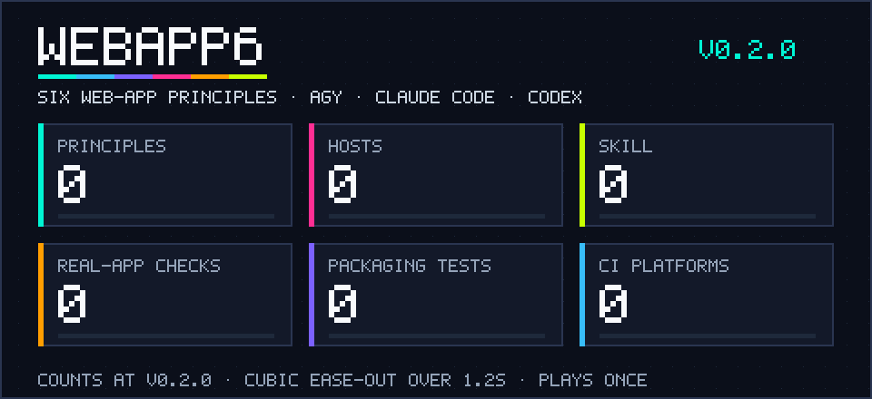
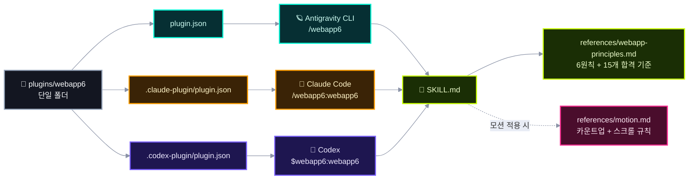
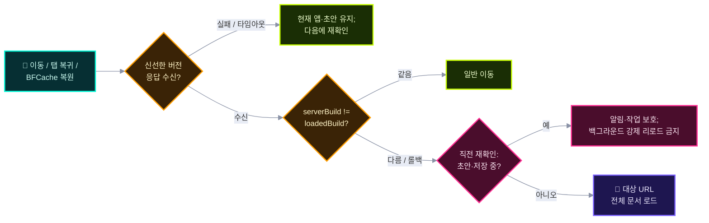
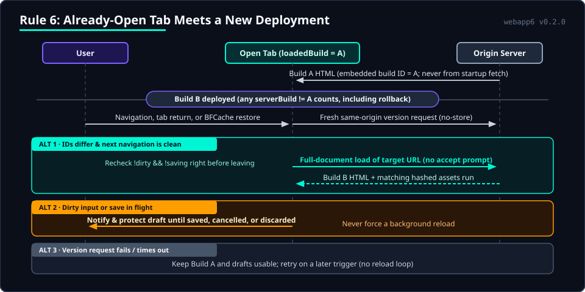
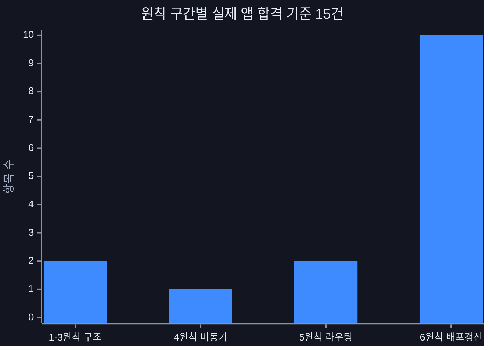
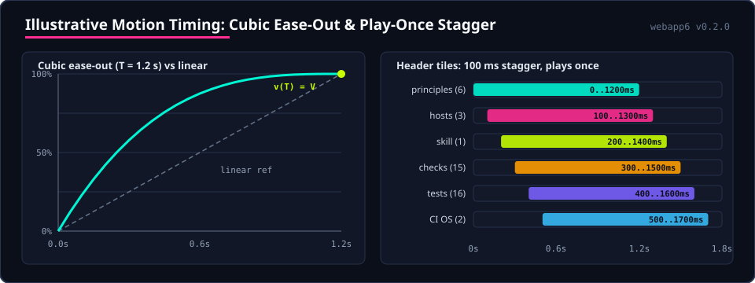

<h1 align="center">⚡ webapp6</h1>

<p align="center">
  <b>웹앱 6원칙을 Antigravity CLI(<code>agy</code>), Claude Code, Codex에 한 번에 설치하는 스킬 플러그인입니다.</b><br>
  AI 코딩 에이전트가 웹앱을 만들거나 고치거나 검토할 때 사용합니다. 선택 항목으로 카운트업 숫자와
  스크롤 애니메이션 규칙이 들어 있습니다.
</p>

<div align="center">

<a href="https://github.com/Technoetic/webapp6/releases/tag/v0.2.0"></a>
<a href="LICENSE"></a>
<a href="https://github.com/Technoetic/webapp6/actions/workflows/ci.yml"></a>
<a href="#-설치"></a>
<br>
<a href="#-웹앱-6원칙"></a>
<a href="#-실제-앱-합격-기준"></a>
<a href="tests/test_plugin.py"></a>
<a href="#-하는-일과-하지-않는-일"></a>

</div>

<p align="center">
  <picture>
    <source media="(prefers-reduced-motion: reduce)" srcset="https://raw.githubusercontent.com/Technoetic/webapp6/main/docs/art/hero.png">
    
  </picture>
</p>

<div align="center">

[English README](README.md) · [변경 이력](CHANGELOG.md) · [보안](SECURITY.md) · [기여 안내](CONTRIBUTING.md) · MIT 라이선스 · v0.2.0

</div>

## 🧭 한눈에 보기

<p align="center">
  <kbd>agy</kbd> <kbd>/webapp6</kbd> &nbsp;·&nbsp; <kbd>Claude Code</kbd> <kbd>/webapp6:webapp6</kbd> &nbsp;·&nbsp; <kbd>Codex</kbd> <kbd>&#36;webapp6:webapp6</kbd>
</p>

경량 플러그인 폴더 하나(`plugins/webapp6/`)에 세 호스트의 매니페스트와 단일 스킬을 담았습니다.
세 호스트 모두 동일한 영문 정본 `SKILL.md`와 두 참고 문서(`references/motion.md`는 모션이 해당할 때만 읽기)를
공유합니다.



> [!NOTE]
> `docs/art/`의 모든 배지·헤더 애니메이션·벡터 도식은 외부 패키지 없이 Python 3 표준 라이브러리만으로 동작하는
> `python tools/generate_art.py`로 생성되며 CI에서 불일치 여부를 자동 검증합니다.

## 🧱 웹앱 6원칙

| # | 원칙 | 지켜야 할 결과 |
|---|---|---|
| 1 | 책임별 JavaScript 모듈 | 진입점·화면·서비스·공통 기능을 소스에서 분리. 단일 HTML 번들 배포도 허용. |
| 2 | CSS 계층 분리 | 디자인 토큰·기본 스타일·컴포넌트 스타일을 소스에서 분리. 기존 스타일 체계가 충족하면 유지. |
| 3 | 화면·서비스 경계 | 별도 관례가 없는 새 코드는 책임별 클래스 사용; hooks·composables 등 프레임워크 관례 유지. |
| 4 | 비동기 로딩과 렌더링 | `async`/`await`로 I/O 처리; 로딩·빈 값·성공·오류 구분 및 취소/요청 ID로 경합 차단. |
| 5 | 단일 진입점과 화면 URL | 화면마다 공유 URL 부여; 딥링크·새로고침·뒤로/앞으로 동작, 없는 자산·API는 진짜 404 반환. |
| 6 | 안전한 배포 갱신 | 열린 탭도 바뀐 배포(롤백 포함)를 감지해 다음 안전한 이동에서 대상 URL을 문서 전체로 자동 로드. |

영문 정본 가이드: [`references/webapp-principles.md`](plugins/webapp6/skills/webapp6/references/webapp-principles.md).

## 🚀 6원칙 한 장 정리

실제 앱 합격 기준 15건 중 10건이 제6원칙(안전한 배포 갱신)을 다룹니다. 이미 열려 있던 탭은 백그라운드
강제 새로고침 없이 새 배포를 감지하고, 다음 안전한 이동에서 대상 URL을 전체 문서로 자동 전환합니다.



다음 이동 대상 URL `u`의 전환 조건:

```math
\mathrm{fullLoad}(u) \Leftarrow \mathrm{id}_{\mathrm{loaded}} \neq \mathrm{id}_{\mathrm{fresh}} \;\land\; \lnot\,\mathrm{dirty} \;\land\; \lnot\,\mathrm{saving}
```

> [!WARNING]
> 수동 새로고침 안내 배너, "업데이트 수락" 버튼, F5 안내만으로는 제6원칙을 충족하지 못합니다.
> 다음 안전한 이동에서 대상 URL을 자동으로 전체 문서 로드해야 합니다.

> [!CAUTION]
> 백그라운드에서 페이지를 강제로 새로고침하지 마세요. 전환 직전에 미저장 입력과 진행 중인 저장을
> 반드시 재확인해 저장·취소·명시적 폐기 전까지 보호해야 합니다.

<p align="center">
  
</p>

## 🧪 실제 앱 합격 기준

변경한 범위에 맞는 항목을 실제 앱 환경에서 실행하고, 미실행 항목은 `untested`, 미지원 항목은 `unsupported`로
구분해 보고합니다.



<details>
<summary><b>합격 기준 15건 전체 보기</b> (1–3원칙: 2 · 4원칙: 1 · 5원칙: 2 · 6원칙: 10)</summary>

| 구분 | 검증 항목 |
|---|---|
| 1–3원칙 구조 | JS·CSS 소스 · 프로젝트 관례 |
| 4원칙 비동기 | 비동기 오류·경합 |
| 5원칙 라우팅 | 직접 링크·새로고침 · Back/Forward·404 |
| 6원칙 배포 갱신 | 새 진입 A → B · 이미 열린 A 탭 · 시작 시점 경합 · 탭 복귀·history 복원 · dirty 입력 · 저장 중·확인 중 편집 · 롤백 B → A · 버전 조회 실패 · 데이터만 갱신 · 자산·인증 캐시 |

</details>

## ✨ 선택 항목: 카운트업·스크롤 애니메이션

랜딩·포트폴리오·소개 화면, KPI 요약 영역, 또는 사용자가 명시적으로 요청할 때만 적용합니다.
세부 영문 정본: [`references/motion.md`](plugins/webapp6/skills/webapp6/references/motion.md).

> [!IMPORTANT]
> 업무 입력 화면, 데이터 표, 실시간 운영 값에는 모션을 넣지 마세요. 모션 규칙과 웹앱 6원칙이
> 부딪히면 6원칙이 우선합니다.

- **내용 우선:** 최종 숫자와 본문을 HTML에 직접 두고, 시작 상태는 스크립트가 붙이는 클래스로만 적용합니다.
- **접근성·인쇄:** `prefers-reduced-motion: reduce`에서는 즉시 최종 상태를 표시하고, 움직이는 숫자는 `aria-hidden="true"` + `.sr-only` 최종값(`aria-live` 금지), `@media print`/`beforeprint`로 인쇄 누락을 막습니다.
- **합성 속성·수명주기:** `transform`·`opacity`만 움직이며, 화면 해제 시 `cancelAnimationFrame`/`disconnect()`와 BFCache(`pagehide`/`pageshow`) 복원을 처리합니다.
- **형식·API 지표:** `Intl.NumberFormat` 사용(`건·명·개` 등 한국어 단위는 `style: 'unit'` 밖으로 분리) 및 API 로딩 자리표시로 `0` 사용 금지.
- **스크롤:** 등장 효과와 `@supports (animation-timeline: scroll())` 진행 표시로 제한하며 스크롤 하이재킹을 금지합니다.

규칙에 부합하는 예시 ease-out 곡선(`1 s <= T <= 2 s`, 목표값 `V` 정확 일치):

$$
v(t) = V\left(1-\left(1-\frac{t}{T}\right)^{3}\right), \qquad 1\text{ s} \le T \le 2\text{ s}, \qquad v(T) = V
$$

<p align="center">
  
</p>

## 🔌 설치

### 🪐 Antigravity CLI (`agy`)

```sh
agy plugin install https://github.com/Technoetic/webapp6/tree/main/plugins/webapp6
```

> [!TIP]
> 이 불변 릴리스에 고정하려면 `https://github.com/Technoetic/webapp6/tree/v0.2.0/plugins/webapp6`을 사용하세요.
> [릴리스 v0.2.0](https://github.com/Technoetic/webapp6/releases/tag/v0.2.0)에 결정적 슬림 플러그인 ZIP과 `SHA256SUMS.txt`도 첨부되어 있습니다.

### 🤖 Claude Code

```sh
claude plugin marketplace add Technoetic/webapp6
claude plugin install webapp6@technoetic-webapp6
```

Claude Code 2.1.275 이상에서는 세션 안에서 한 번에 설치할 수도 있습니다:
`/plugin install webapp6 --marketplace Technoetic/webapp6`

### 🧠 Codex

```sh
codex plugin marketplace add Technoetic/webapp6
codex plugin add webapp6@technoetic-webapp6
```

## 🎯 사용

| 호스트 | 부르는 법 |
|---|---|
| Claude Code | `/webapp6:webapp6 결제 화면 검토해 줘` (웹앱 작업이면 자동 선택 가능) |
| Codex | `$webapp6:webapp6 결제 화면 검토해 줘` |
| Antigravity CLI | `/webapp6 결제 화면 검토해 줘` (웹앱 작업이면 자동 선택 가능) |

대상을 적지 않으면 현재 대화의 웹앱 작업에 적용하고, 진행 중인 웹앱 작업이 없으면 앱을 새로 만들지 않고
규칙과 호출법만 안내합니다.

## 🔒 하는 일과 하지 않는 일

- **텍스트 + 아이콘 전용:** `assets/icon.png`(`1024×1024`) 외에 `plugins/webapp6/`은 순수 텍스트 파일만
  포함합니다(`SKILL.md`, 영문 정본 참고 문서 2종, `agents/openai.yaml`, 3호스트 매니페스트, `README.md`,
  `LICENSE`). 스크립트·훅·MCP 서버·네트워크 호출이 전혀 없습니다.
- **호스트 권한 존중:** 에이전트가 임의로 설치·배포·호스트 설정을 바꾸지 않도록 지시하며, 실제 권한과
  승인은 사용하는 호스트 정책을 따릅니다.
- **정직한 검증 경계:** 실제로 검증한 항목과 미검증 항목을 구분해 보고하도록 지시합니다. 스킬 발견은
  지침 전달을 뜻할 뿐 준수 자체를 보장하지 않습니다.

## 📁 저장소 구조

```text
.                                        ← 저장소 루트
├── .claude-plugin/marketplace.json      ← Claude Code 마켓플레이스
├── .agents/plugins/marketplace.json     ← Codex 마켓플레이스
├── .github/workflows/ci.yml             ← 시험 + 아트 드리프트 + ZIP 결정성 CI (Ubuntu·Windows)
├── docs/art/                            ← 재현 가능한 배지, 1회 재생 히어로, 벡터 SVG 2종
├── plugins/webapp6/                     ← 3호스트 공용 단일 설치 플러그인 (~37 KiB, 10개 파일)
│   ├── plugin.json                      ← Antigravity 매니페스트
│   ├── .claude-plugin/plugin.json       ← Claude Code 매니페스트
│   ├── .codex-plugin/plugin.json        ← Codex 매니페스트
│   ├── README.md                        ← 플러그인 단위 안내
│   ├── LICENSE                          ← 플러그인 동봉 MIT 라이선스 사본
│   ├── assets/icon.png                  ← 1024 x 1024 플러그인 아이콘
│   └── skills/webapp6/
│       ├── SKILL.md                     ← 체크리스트·범위·호출 안내
│       ├── agents/openai.yaml           ← Codex 표시 메타데이터
│       └── references/
│           ├── webapp-principles.md     ← 영문 정본 6원칙 + 15개 합격 기준
│           └── motion.md                ← 영문 정본 선택 모션 규칙
├── tests/test_plugin.py                 ← 16개 패키징·링크·앵커·위생·아트·ZIP 시험
└── tools/
    ├── generate_art.py                  ← 무의존성 stdlib docs/art/ 생성기 및 --check
    └── build_release_zip.py             ← 결정적 UTC 슬림 플러그인 ZIP + SHA256SUMS 생성기
```

## 🧬 출처 및 라이선스

웹앱 6원칙은 [Technoetic/agentic-vault](https://github.com/Technoetic/agentic-vault) (`v0.56.0`, MIT)의
`docs/webapp-principles.md`를 독립 설치용으로 옮긴 것입니다. [MIT 라이선스](LICENSE)로 배포됩니다.
