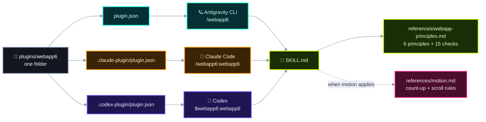
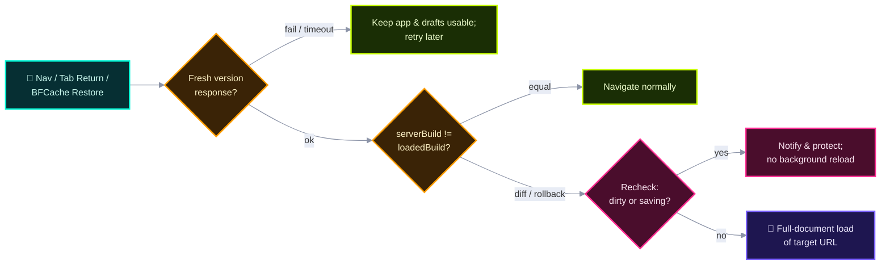
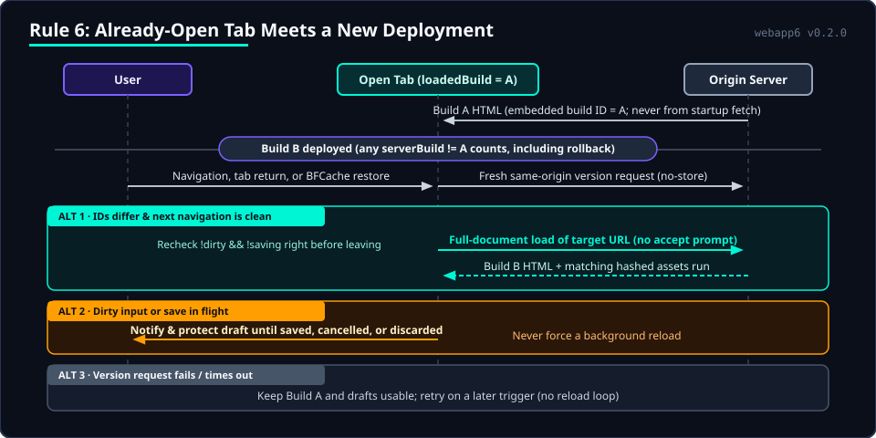
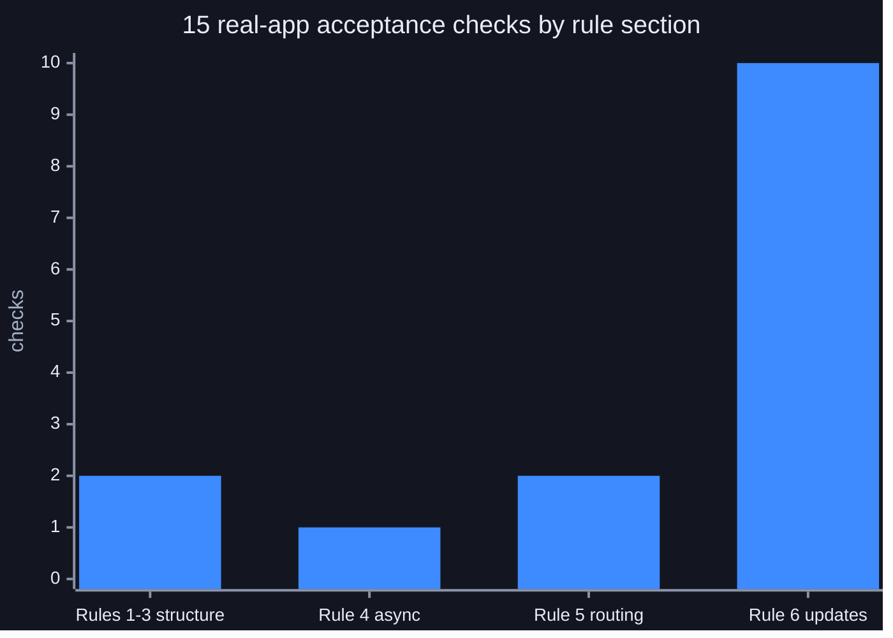
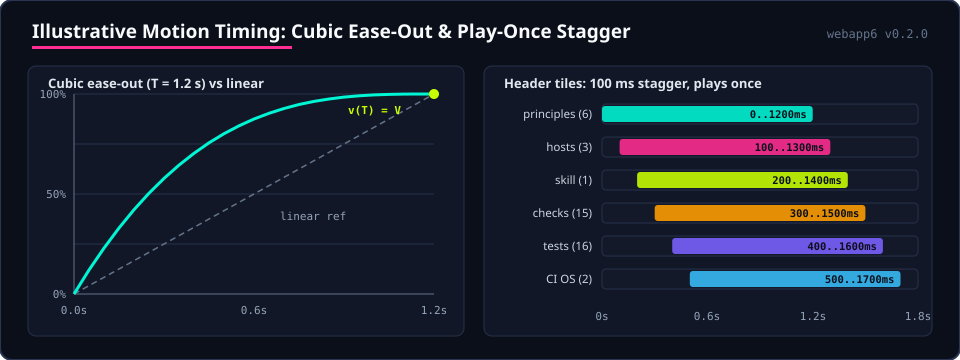

<h1 align="center">⚡ webapp6</h1>

<p align="center">
  <b>Six web-app principles as one installable skill for Antigravity CLI (<code>agy</code>), Claude Code, and Codex.</b><br>
  Use it when an AI coding agent builds, changes, or reviews a web app. An optional rule set covers
  count-up numbers and scroll animations.
</p>

<div align="center">

<a href="https://github.com/Technoetic/webapp6/releases/tag/v0.2.0"></a>
<a href="LICENSE"></a>
<a href="https://github.com/Technoetic/webapp6/actions/workflows/ci.yml"></a>
<a href="#-install"></a>
<br>
<a href="#-the-six-principles"></a>
<a href="#-real-app-acceptance-checks"></a>
<a href="tests/test_plugin.py"></a>
<a href="#-what-the-plugin-does-and-does-not-do"></a>

</div>

<p align="center">
  <picture>
    <source media="(prefers-reduced-motion: reduce)" srcset="https://raw.githubusercontent.com/Technoetic/webapp6/main/docs/art/hero.png">
    
  </picture>
</p>

<div align="center">

[한국어 README](README.ko.md) · [Changelog](CHANGELOG.md) · [Security](SECURITY.md) · [Contributing](CONTRIBUTING.md) · MIT License · v0.2.0

</div>

## 🧭 At a glance

<p align="center">
  <kbd>agy</kbd> <kbd>/webapp6</kbd> &nbsp;·&nbsp; <kbd>Claude Code</kbd> <kbd>/webapp6:webapp6</kbd> &nbsp;·&nbsp; <kbd>Codex</kbd> <kbd>&#36;webapp6:webapp6</kbd>
</p>

One lightweight plugin folder (`plugins/webapp6/`) carries a manifest for each host and a single skill.
All three hosts receive the same English canonical `SKILL.md` and two reference guides (`references/motion.md`
is read only when count-up or scroll animations are in scope).



> [!NOTE]
> All counts, badges, header animations, and vector diagrams in `docs/art/` are generated directly from
> this repository by `python tools/generate_art.py` (Python 3 standard library only) and verified in CI.

## 🧱 The six principles

| # | Principle | Required outcome |
|---|---|---|
| 1 | Responsibility-based JS | Split entry, screens, services, and shared utilities in source. Bundled single-HTML output stays valid. |
| 2 | Layered CSS | Separate design tokens, base styles, and components in source. Preserve existing CSS systems that do this. |
| 3 | Screen/service boundaries | Use classes per responsibility in new code without conventions; keep framework hooks or composables. |
| 4 | Async loading & rendering | Use `async`/`await`; render loading, empty, success, and error states; cancel or guard stale races. |
| 5 | Single entry & screen URLs | Give screens shareable URLs; deep links, refresh, and Back/Forward work; missing assets/APIs return 404. |
| 6 | Safe deployment updates | Open tabs detect a changed build (including rollback) and full-load the target URL on clean navigation. |

Full canonical guide (English): [`references/webapp-principles.md`](plugins/webapp6/skills/webapp6/references/webapp-principles.md).

## 🚀 Rule 6 in one picture

Rule 6 accounts for 10 of the 15 real-app acceptance checks. An already-open tab notices a changed build
without forcing a background reload, and automatically loads the target URL as a full document on the next
clean navigation.



The transition condition for target URL `u`:

```math
\mathrm{fullLoad}(u) \Leftarrow \mathrm{id}_{\mathrm{loaded}} \neq \mathrm{id}_{\mathrm{fresh}} \;\land\; \lnot\,\mathrm{dirty} \;\land\; \lnot\,\mathrm{saving}
```

> [!WARNING]
> A manual reload banner, an accept-update button, or telling users to press F5 do **not** satisfy Rule 6.
> The next clean navigation must load the target URL as a full document automatically.

> [!CAUTION]
> Never force a background reload. Recheck both dirty input and saves in flight immediately before leaving,
> and protect work until saved, cancelled, or explicitly discarded.

<p align="center">
  
</p>

## 🧪 Real-app acceptance checks

Run the rows matching your change scope in a real app environment and record observed results separately
from `untested` or `unsupported` rows.



<details>
<summary><b>View all 15 acceptance checks</b> (Rules 1–3: 2 · Rule 4: 1 · Rule 5: 2 · Rule 6: 10)</summary>

| Section | Checks |
|---|---|
| 1–3 structure | JS and CSS sources · Project conventions |
| 4 async | Async errors and races |
| 5 routing | Direct links and refresh · Back/Forward and 404 |
| 6 deployment updates | Fresh entry A → B · Already-open A tab · Startup race · Tab return and history restore · Dirty input · Editing while saving or checking · Rollback B → A · Version check failure · Data-only update · Asset and auth cache |

</details>

## ✨ Optional: count-up and scroll animations

Apply **only** for landing, portfolio, and introduction pages, KPI summaries, or on explicit request.
See [`references/motion.md`](plugins/webapp6/skills/webapp6/references/motion.md).

> [!IMPORTANT]
> Never add motion to data-entry screens, tables, or live operational values. If any motion rule conflicts
> with the six principles, the six principles win.

- **Content first:** Final numbers and text live in HTML; initial states apply only via a script-added class.
- **Accessibility & print:** Respect `prefers-reduced-motion: reduce`; mark moving digits `aria-hidden="true"` with `.sr-only` final text (no `aria-live`); override hidden states in `@media print` or `beforeprint`.
- **Compositor & lifecycle:** Animate `transform` and `opacity` only; clean up `requestAnimationFrame`/observers on unmount and restore cleanly across BFCache (`pagehide`/`pageshow`).
- **Formatting & API metrics:** Use `Intl.NumberFormat` (keep non-CLDR units such as Korean `건·명·개` outside `style: 'unit'`); never show `0` as a loading placeholder for API-fed values.
- **Scroll:** Subtle reveals and `@supports (animation-timeline: scroll())` progress indicators only; no scroll hijacking.

Illustrative ease-out curve matching the rule (`1 s <= T <= 2 s`, landing exactly on `V`):

$$
v(t) = V\left(1-\left(1-\frac{t}{T}\right)^{3}\right), \qquad 1\text{ s} \le T \le 2\text{ s}, \qquad v(T) = V
$$

<p align="center">
  
</p>

## 🔌 Install

### 🪐 Antigravity CLI (`agy`)

```sh
agy plugin install https://github.com/Technoetic/webapp6/tree/main/plugins/webapp6
```

> [!TIP]
> Pin to this immutable release: `https://github.com/Technoetic/webapp6/tree/v0.2.0/plugins/webapp6`
> (a deterministic slim plugin ZIP + `SHA256SUMS.txt` are also attached to [Release v0.2.0](https://github.com/Technoetic/webapp6/releases/tag/v0.2.0)).

### 🤖 Claude Code

```sh
claude plugin marketplace add Technoetic/webapp6
claude plugin install webapp6@technoetic-webapp6
```

On Claude Code 2.1.275 or later, you can also install in one step inside a session:
`/plugin install webapp6 --marketplace Technoetic/webapp6`

### 🧠 Codex

```sh
codex plugin marketplace add Technoetic/webapp6
codex plugin add webapp6@technoetic-webapp6
```

## 🎯 Use

| Host | Invocation |
|---|---|
| Claude Code | `/webapp6:webapp6 review the checkout page` (or let it trigger on web-app work) |
| Codex | `$webapp6:webapp6 review the checkout page` |
| Antigravity CLI | `/webapp6 review the checkout page` (or let it trigger on web-app work) |

With no target, the skill applies the rules to the web-app work in the current conversation; if there is
none, it explains the rules and invocation without creating an app.

## 🔒 What the plugin does and does not do

- **Text + icon only:** Apart from `assets/icon.png` (`1024×1024`), `plugins/webapp6/` ships only text
  (`SKILL.md`, two English canonical reference docs, `agents/openai.yaml`, three host manifests, `README.md`,
  and `LICENSE`). Zero scripts, hooks, MCP servers, or network calls.
- **Respects host approvals:** The skill instructs agents not to install, deploy, or change host settings
  without explicit user direction; your host's permissions always apply.
- **Honest verification boundaries:** The skill requires reporting verified vs untested items separately.
  Skill discovery proves delivery, not guaranteed agent compliance.

## 📁 Repository layout

```text
.                                        ← repository root
├── .claude-plugin/marketplace.json      ← Claude Code marketplace
├── .agents/plugins/marketplace.json     ← Codex marketplace
├── .github/workflows/ci.yml             ← tests + art drift + ZIP determinism (Ubuntu & Windows)
├── docs/art/                            ← reproducible badges, play-once hero, 2 vector SVGs
├── plugins/webapp6/                     ← single installable plugin (~37 KiB, 10 files) for all 3 hosts
│   ├── plugin.json                      ← Antigravity manifest
│   ├── .claude-plugin/plugin.json       ← Claude Code manifest
│   ├── .codex-plugin/plugin.json        ← Codex manifest
│   ├── README.md                        ← plugin-scoped overview
│   ├── LICENSE                          ← MIT license copy shipped in the plugin
│   ├── assets/icon.png                  ← 1024 x 1024 plugin icon
│   └── skills/webapp6/
│       ├── SKILL.md                     ← checklist, scope, invocation
│       ├── agents/openai.yaml           ← Codex display metadata
│       └── references/
│           ├── webapp-principles.md     ← English canonical 6 principles + 15 checks
│           └── motion.md                ← English canonical optional motion rules
├── tests/test_plugin.py                 ← 16 packaging, link, anchor, hygiene, art & ZIP tests
└── tools/
    ├── generate_art.py                  ← zero-dependency stdlib docs/art/ generator & --check
    └── build_release_zip.py             ← deterministic UTC slim plugin ZIP + SHA256SUMS builder
```

## 🧬 Origin & License

The six principles are adapted from `docs/webapp-principles.md` in
[Technoetic/agentic-vault](https://github.com/Technoetic/agentic-vault) (`v0.56.0`, MIT) for standalone
installation. Released under the [MIT License](LICENSE).
